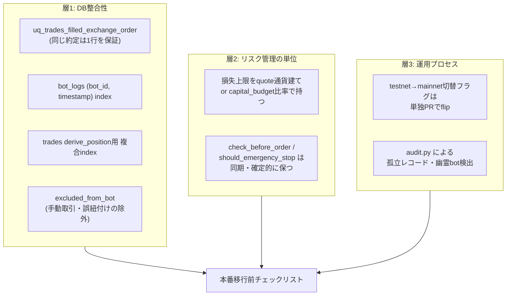

AutoTrader (FastAPI × React Native Expo 製) の自動売買botを、ペーパートレードから本番稼働へ移す際のチェック項目をどう決めるかを整理した。制約は「移行判断を勘や経験則に頼らない」「個人運用でレビュー体制を厚くできない」「通貨単位が異なるbotが混在しても同じ基準で判定したい」の3つ。この記事では、移行チェックリストの中身をコードやドキュメントの規約から逆算した設計判断を中心に書く。

## 前提

### 解きたい問題

ペーパートレードで動作確認をしたbotを本番に切り替える際、何をもって「移行してよい」と判断するかは曖昧になりやすい。個人運用では、レビューをする第三者がいるわけではないため、判断基準を「実装済みの規約・制約」に落とし込んでおく必要がある。

AutoTraderでは `backend/CLAUDE.md` に運用上の規約が蓄積されており、そのいくつかは過去の事故を踏まえて明文化されている。今回はこの規約群を、ペーパートレードから本番移行するときのチェックリストとして再整理する。感覚的な「大丈夫そう」ではなく、コード上の制約や過去の障害記録に基づいたチェック項目を組み立てる。

### 環境

- FastAPI（バックエンド）
- ccxt（複数取引所・複数quote通貨のbotを収容）
- PostgreSQL（trades / bot_logs / bots テーブル）
- Alembic（スキーマ管理）
- `backend/CLAUDE.md`（運用規約の集積地）
- 個人運用、複数botが並行稼働

## 設計案の比較

チェックリストをどこに置くか、どういう粒度で持つかという点も検討した。評価軸は「形骸化しにくさ」「更新のしやすさ」「本番移行という一回性のイベントとの相性」の3つ。

### 案A: 移行手順書としてドキュメントに箇条書きで残す

「テストネットで一定期間動かす」「損失上限を確認する」といった項目を、READMEや別ドキュメントに文章で列挙する。

**メリット**: すぐ書ける。項目の追加・削除も自由。

**デメリット**: ドキュメントとコードが乖離しやすい。実際の制約（DBのインデックスやunique制約、フラグの切り替え方法）が変わっても、ドキュメント側の更新を忘れると形骸化する。

### 案B: 移行判断そのものをコードでチェックするスクリプトにする

本番移行前に自動実行するスクリプトを用意し、DBの状態やbotの設定値をプログラムで検証する。

**メリット**: 実行するだけで機械的にチェックできる。人間の見落としが起きにくい。

**デメリット**: チェック項目の中には「testnet/mainnet切替フラグを単独PRにする」のような、コードだけでは検証しきれない運用プロセス上の規律も含まれる。スクリプト化できる範囲とできない範囲が混在する。

### 案C: 既存の規約・過去の障害記録から逆算したチェックリストとして持つ（採用）

`backend/CLAUDE.md` に記録された規約や、実際に起きた障害の記録（誤発火・ANOMALY連発など）を根拠に、本番移行前に確認すべき項目を洗い出す。項目自体はドキュメントとして残すが、その内容は「コード上の制約」や「過去の事故」に紐づけて書く。

**メリット**: チェック項目が抽象論ではなく、実際に起きた・起きうる不整合に基づいているため、なぜそのチェックが必要かの根拠が明確になる。コード側の変更（マイグレーションやフラグの追加）があれば、対応するチェック項目も見直すきっかけになる。

**デメリット**: 案Aと同様、実行の強制力は無い。チェックリストを見ながら人間が確認する運用に依存する部分は残る。

**案Bと案Cを比較して案Cを選んだ理由**: 案Bはチェックの自動化という点で魅力的だが、`CLAUDE.md` に記録されている規約の中には「testnet → mainnet の切替フラグをPRの中でflipしない、フラグ変更は単独PRにする」のような、コードの実行結果ではなくPRの粒度・レビューの進め方そのものを制約する項目がある。こうした項目は自動チェックの対象にしにくい。個人運用でスクリプトのメンテナンスコストまで背負うより、まずは「何を確認すべきか」を過去の事故から漏れなく言語化する方を優先し、案Cを選んだ。

## 採用した設計

チェックリストは大きく3つの層に分けて整理した。DBの整合性、リスク管理の単位、運用プロセスの3層になる。

### 層1: DBの整合性を確認する

同じ約定が重複して記録されていないか、集計クエリが実データと一致する経路を通っているかを確認する層。`CHANGELOG.md` には、同日の重複補正の再発防止として `uq_trades_filled_exchange_order` という部分unique indexを追加した記録がある。条件は `order_status='FILLED' AND order_id IS NOT NULL AND order_id <> '' AND order_id <> '0'` で、アプリ側のガードだけでなくDB側にも一意制約を持たせている。本番移行前には、こうした制約が想定通りの条件で機能しているかを確認する項目として扱う。

あわせて、`derive_position()` のWHERE句（`bot_id` / `order_status='FILLED'` / `excluded_from_bot=False` / `cycle_closed_at IS NULL`）に対応する複合indexが存在するか、`bot_logs` の `(bot_id, timestamp)` indexが機能しているかも、集計・ログ取得が全件スキャンにならないかという観点でチェック項目に含めている。`excluded_from_bot` のようなフラグが、手動取引や誤紐付けを正しく除外できているかも、本番集計を汚さないための確認点になる。

### 層2: リスク管理の単位を確認する

`CLAUDE.md` には、損失上限を「単一通貨前提の絶対額」でハードコードしないという規約がある。比較対象のPnLはbotのquote通貨で累積されるため、USDT前提の絶対値をJPY建てbotにそのまま適用すると約150倍厳しい閾値になり、実際に少額の実損で緊急停止が誤発火した経緯が記録されている。本番移行するbotのquote通貨が何であれ、損失上限がquote通貨建てで解釈されているか、`capital_budget` に対する比率で持たれているかを確認する項目として扱う。

同じ層で、`check_before_order` / `should_emergency_stop` が同期・確定的に保たれているか、つまり為替換算のようなネットワーク越しの取得処理がhot pathに紛れ込んでいないかも確認する。ペーパートレード中は問題にならなかった処理が、本番の負荷やタイミングで表面化するケースを避けるための項目になる。

### 層3: 運用プロセスを確認する

`CLAUDE.md` には、testnetからmainnetへの切替フラグをPRの中でflipしない、フラグ変更は単独PRにするという規約がある。本番移行の直前は、機能追加とフラグ切替を同時にコミットしたくなる誘因が働きやすいタイミングでもあるため、あえて独立した確認項目として残している。

`audit.py` による孤立レコード・幽霊bot検出も、本番移行前後に一度実行しておく価値がある層として位置づけている。孤立した取引・孤立したWebhook・孤立したログ・「RUNNINGのはずなのに実体がない幽霊bot」・孤立したアラートという5種類のチェックを1回の監査でまとめて実行し、件数を集計する仕組みになっており、移行直後の状態を機械的に確認する手段として使える。

## 実装上の罠

### 罠1: DBマイグレーションの適用漏れ

チェックリストの層1に挙げた `uq_trades_filled_exchange_order` や各種インデックスは、いずれもAlembicのマイグレーションとして追加されたものになる。本番環境に対してこれらのマイグレーションが実際に適用済みかどうかは、ペーパートレード環境と本番環境でスキーマがずれていないかという観点で確認する必要がある。ペーパートレードの検証環境だけを見て「動いている」と判断すると、本番DB側の制約が実は古いままという状態を見落とす。

### 罠2: quote通貨が異なるbotを同じ基準で見てしまう

層2のチェックは、bot単位で確認する必要がある点に注意が要る。損失上限の単位を見直した経緯自体が「通貨単位を誤ると桁違いの閾値になる」という事故から来ているため、複数のbotを一括で「損失上限は問題ない」と判断せず、bot ごとのquote通貨を確認したうえでチェックする必要がある。

### 罠3: コネクションプールの余力を見落とす

`database.py` には、複数botの定期実行とAPIリクエスト、定期監査が重なる瞬間にコネクションが不足していたという設計判断の記録がある。`POOL_SIZE = 10` は「6 BOT + API + 定期監査が重なる瞬間に既定の5では足りない」という理由で設定されており、本番移行で稼働bot数が増える際は、このプールサイズの余力が引き続き足りているかを確認する項目に含めておく必要がある。`POOL_TIMEOUT_SEC` はgunicornのタイムアウトより十分短く設定され、失敗を早く返して次サイクルで自己回復させる思想になっているため、稼働bot数の増加がこの前提を崩していないかも見ておく必要がある。

## 振り返り

ペーパートレードから本番移行のチェックリストを作る際、抽象的な「気をつけるポイント集」ではなく、実際にDBに刻まれた制約やコード上のコメントから逆算する形にした。unique indexや複合indexの追加理由、損失上限の単位変更の経緯、プールサイズの根拠、いずれも一度何らかの形で問題が表面化したことに紐づいている記録になる。

このやり方の限界は、コード側に規約や制約として現れていない観点を拾えない点にある。案Cを選んだ時点で、チェックリストの網羅性は「これまでに明文化された規約の範囲」に依存する構造になっている。それでも、感覚や経験則だけに頼るより、DBの制約やコード上のコメントという動かしがたい根拠に基づいてチェック項目を組む方が、個人運用でレビュー体制を厚くできない状況には合っていると感じている。

---

## 関連リンク

[AutoTrader 実装学習キット (FastAPI × React Native)](https://autotrader.ponfreelance.com/sales/?utm_source=zenn&utm_medium=article&utm_campaign=%E3%83%9A%E3%83%BC%E3%83%91%E3%83%BC%E3%83%88%E3%83%AC%E3%83%BC%E3%83%89%E3%81%8B%E3%82%89%E6%9C%AC%E7%95%AA%E7%A7%BB%E8%A1%8C%E3%81%AE%E3%83%81%E3%82%A7%E3%83%83%E3%82%AF%E3%83%AA%E3%82%B9%E3%83%88)

by ぽん ([@pon_freelance](https://x.com/pon_freelance))

**開発の裏側を購読できます** — AutoTrader のリリースごとに「何を・なぜ・どう変えたか」を 2,000〜4,000 字で書き残しています。バグの原因、取引所 API 変更への追従、設計判断のトレードオフまで。
→ [AutoTrader開発ログ（月500円・いつでも解約可）](https://note.com/clab_jp/membership)
