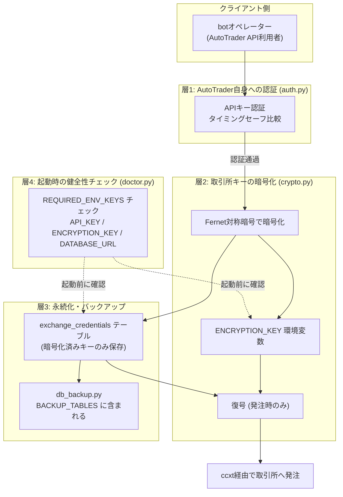

AutoTrader (FastAPI × React Native Expo 製) の自動売買botで、取引所APIキー・シークレットの保護をどう層構造で組むかを整理した。制約は「取引所APIキーという最重要資産を扱う」「個人運用でレビュー体制を厚くできない」「バックアップやDBダンプという別経路からの漏洩も塞ぐ」の3つ。この記事では、認証・暗号化・バックアップという複数の層をどう役割分担させたかという設計判断を中心に書く。

## 前提

### 解きたい問題

自動売買botは、取引所APIキー・シークレットという、漏れれば直接的な被害につながる情報を扱う。AutoTraderでは、この情報の保護を単一の仕組みに頼らず、複数の層に分けて設計している。

`backend/auth.py` は、AutoTrader自身のAPIに対する認証を担うモジュールで、コメントには「APIキーによるシンプルな認証を提供する」「タイミングセーフな比較でサイドチャネル攻撃を防止」とある。これはAutoTraderのAPI自体への認証であり、取引所側のAPIキーとは別の話になる。取引所側のAPIキー・シークレットは `backend/crypto.py` が担当し、コメントには「取引所APIキー・シークレットをFernet対称暗号で暗号化/復号する」「ENCRYPTION_KEY環境変数から鍵を生成する」とある。

この記事で扱うのは、この2つの層（AutoTrader自身への認証・取引所キーの暗号化）が、なぜ別々のモジュールとして分かれているか、そして暗号化した後の値がどこまで安全に扱われる必要があるかという設計判断になる。

### 環境

- FastAPI（バックエンド）
- ccxt（取引所クライアント）
- PostgreSQL（`exchange_credentials` テーブルに暗号化済みキーを保持）
- `backend/auth.py`（APIキー認証）
- `backend/crypto.py`（Fernet対称暗号）
- `backend/db_backup.py`（バックアップ対象テーブルの管理）
- `backend/doctor.py`（環境変数の健全性チェック）
- 個人運用、複数botが並行稼働

## 設計案の比較

比較したのは「取引所APIキー・シークレットを、DB・バックアップ・環境変数という複数の経路からどう保護するか」という点。評価軸は「単一障害点の有無」「運用中の見落としやすさ」「復旧時の一貫性」の3つ。

### 案A: DBのアクセス制御だけに頼る

DB自体への接続を制限し、アプリケーション経由でのみ取引所APIキーを読み書きできるようにする。カラム自体は平文で保存する。

**メリット**: 実装がシンプルで、暗号化・復号のコードを別途持つ必要がない。

**デメリット**: DBダンプやバックアップファイルがそのまま流出した場合、取引所APIキーが平文で読める状態になる。`backend/db_backup.py` の `BACKUP_TABLES` には `exchange_credentials` が含まれており、コメントにも「暗号化済 API キー」と明記されている。バックアップという経路は、DBへの直接アクセス制御とは別の攻撃面になるため、DBのアクセス制御だけでは塞ぎきれない。

### 案B: アプリケーション層で対称暗号をかけてからDBに保存する（採用）

`backend/crypto.py` のように、DBに書き込む前にFernet対称暗号でキー・シークレットを暗号化し、復号時にのみ環境変数由来の鍵を使う。

**メリット**: DBダンプやバックアップファイルが単体で流出しても、暗号化された状態のままなので、`ENCRYPTION_KEY` を別途持ち出さない限り取引所APIキーとしては使えない。バックアップ対象に `exchange_credentials` が入っていても、それ自体が「暗号化済みAPIキー」であるという前提が成立する。

**デメリット**: 復号のための鍵（`ENCRYPTION_KEY`）の管理という新しい責務が発生する。鍵自体の管理・ローテーションを誤ると、暗号化していても実質的に平文と変わらない状態になり得る。

**案Aと案Bを比較して案Bを選んだ理由**: バックアップという経路は個人運用でも避けて通れない。`db_backup.py` がバックアップ対象として `products` / `bots` / `exchange_credentials` / `trades` / `bot_logs` / `backtest_jobs` を挙げている以上、バックアップファイル自体が持ち出される可能性をゼロにはできない。DBへのアクセス制御だけに頼る案Aは、この経路に対して無力になる。暗号化をアプリケーション層に持たせる案Bであれば、バックアップという経路が漏れても、暗号鍵という別の要素がなければ復元できない。この「経路が漏れても即座に使える形では漏れない」状態を作れる点で、案Bを選んだ。

## 採用した設計

### 全体アーキテクチャ

AutoTraderにおけるAPIキー・シークレット保護は、大きく2つの独立した認証・暗号化の層と、それを横断するバックアップ・環境変数チェックの層で構成されている。

### 層1と層2を分離した理由

`auth.py` が担う認証と `crypto.py` が担う暗号化は、目的が異なる別の層として実装されている。`auth.py` はAutoTrader自身のAPIに対して「誰がリクエストしているか」を確認する層であり、コメントにある「タイミングセーフな比較」は、比較にかかる時間の差から正しいAPIキーを推測されるサイドチャネル攻撃を防ぐための配慮になる。一方 `crypto.py` は、DBに保存する取引所APIキー・シークレットという「データそのもの」を暗号化する層で、認証を通過した後のリクエストが実際に取引所へアクセスする際に、復号された値を使う構成になる。

この2つを1つのモジュールにまとめず分離しているのは、責務が異なるためだと考えられる。認証は「リクエストの正当性」を扱い、暗号化は「保存データの機密性」を扱う。どちらか一方が破られても、もう一方が独立して機能する構成にしておくことで、片方の実装ミスがもう片方まで巻き込む状況を避けやすくなる。

### 鍵の在り処を環境変数に閉じる

`crypto.py` のコメントには「ENCRYPTION_KEY環境変数から鍵を生成する」とある。暗号化・復号に使う鍵をコードやDBではなく環境変数に置くことで、DBダンプが流出しても鍵そのものは別経路（環境変数・デプロイ設定）でしか手に入らない状態を保っている。`doctor.py` の `REQUIRED_ENV_KEYS` に `API_KEY` / `ENCRYPTION_KEY` / `DATABASE_URL` が並んでいる点からも、この3つがシステムの起動可否を左右する最重要の環境変数として扱われていることがわかる。

## 実装上の罠

### 罠1: 必須環境変数のチェックを「コードが実際に参照するものだけ」に絞る

`doctor.py` のコメントには「コードが実際に参照する必須キーのみ（auth.py / crypto.py / database.py で確認済み）」とある。これは裏を返すと、チェック対象を安易に増やしたり、逆に見落として減らしたりすると、起動時チェックと実際のコードの参照範囲がずれる可能性があるということになる。`ENCRYPTION_KEY` のような機密性の高い鍵ほど、「チェックしているつもりで実は見ていない」状態を避けるために、参照元のコード（`auth.py` / `crypto.py` / `database.py`）と対応関係を保つ必要がある。

### 罠2: 雛形値がそのまま残っていても「設定済み」に見えてしまう

`doctor.py` には「雛形値（setup-guide.md と build-packages.sh の配布 .env の両方）。このまま残っていたら未設定と同じ」という記述がある。`ENCRYPTION_KEY` のような値は、配布用の `.env` にダミー値が入っていることがあり、そのダミー値のまま起動してしまうと、環境変数自体は「設定されている」ように見えても実質的には未設定と同じ状態になる。暗号化の鍵という性質上、この種の見落としは「暗号化しているつもりが実質的に固定鍵で運用している」ことにつながりかねず、雛形値の検出は単なる利便性チェックではなく漏洩防止の一部として機能している。

### 罠3: バックアップ対象に含めることと、バックアップの取り扱いは別問題

`db_backup.py` の `BACKUP_TABLES` に `exchange_credentials` が含まれ、コメントに「暗号化済 API キー」と明記されている点は、バックアップに含めること自体は前提として許容されているとわかる。ただし、これは「暗号化されているから含めてよい」という設計上の判断であり、暗号化の層（`crypto.py` と `ENCRYPTION_KEY`）が正しく機能していることが大前提になる。バックアップに含めるテーブルを増減する際は、そのテーブルが暗号化済みの値のみを持つのか、平文の機微情報を含む可能性があるのかを、都度確認する必要がある。

## 振り返り

取引所APIキーの保護を、認証・暗号化・バックアップ・起動時チェックという複数の層に分けて設計している点は、単一の仕組みに頼らないという方針の表れだと捉えている。`auth.py` の認証層はAutoTrader自身へのアクセスを制御し、`crypto.py` の暗号化層はDBやバックアップという別経路からの漏洩を想定した備えになっている。どちらか一方だけでは、想定していない経路（サイドチャネル攻撃・バックアップファイルの流出）に対応しきれない。

`doctor.py` が担う起動時チェックも、単に「環境変数が空でないか」を見るだけでなく、雛形値がそのまま残っていないかまで確認している点は、実際にコードが参照する範囲と対応させて考えられている。秘密鍵・シークレットの保護は、暗号化アルゴリズムを選ぶことだけで完結せず、鍵の管理・バックアップの扱い・起動前チェックという周辺の運用まで含めて初めて機能する。個人運用でレビュー体制を厚くできない状況では、こうした周辺のチェックをコードや起動プロセスに埋め込んでおくことが、見落としを減らす現実的な手段になると考えている。

---

## 関連リンク

[AutoTrader 実装学習キット (FastAPI × React Native)](https://autotrader.ponfreelance.com/sales/?utm_source=zenn&utm_medium=article&utm_campaign=%E7%A7%98%E5%AF%86%E9%8D%B5-%E3%82%B7%E3%83%BC%E3%82%AF%E3%83%AC%E3%83%83%E3%83%88%E6%BC%8F%E6%B4%A9%E4%BA%8B%E6%95%85%E3%81%AE%E9%98%B2%E6%AD%A2)

by ぽん ([@pon_freelance](https://x.com/pon_freelance))

**開発の裏側を購読できます** — AutoTrader のリリースごとに「何を・なぜ・どう変えたか」を 2,000〜4,000 字で書き残しています。バグの原因、取引所 API 変更への追従、設計判断のトレードオフまで。
→ [AutoTrader開発ログ（月500円・いつでも解約可）](https://note.com/clab_jp/membership)
