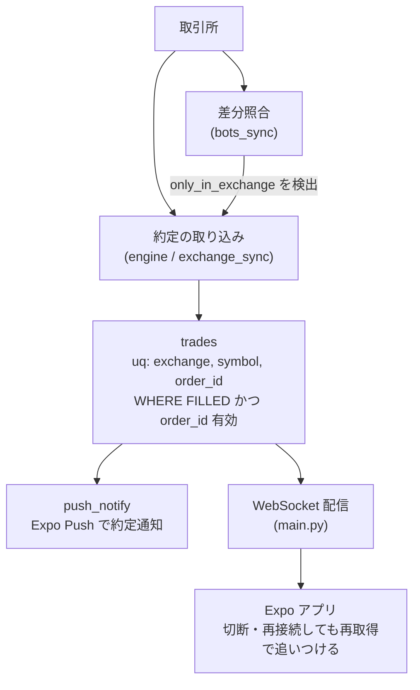

AutoTrader (FastAPI × React Native Expo 製) の自動売買botで、WebSocket 配信と約定記録をどう分担させ、再接続や取りこぼしを前提に約定を失わない構成をどう考えたかを整理した。制約は「BOT は毎分回る」「個人運用でレビュー体制を厚くできない」「取引所ごとに約定取得 API の対応状況が違う」の3つ。この記事は、材料として与えられたコード抜粋から読み取れる設計を解説する形で書く。再接続のバックオフ実装そのものはこの材料には現れないため、そこには踏み込まず、「再接続しても二重にも欠落にもならない土台」を中心に書く。

## 前提

### 解きたい問題

WebSocket は切れる。切れている間に起きた約定をクライアントやサーバーが受け取れないのは、接続方式の性質として避けられない。取りこぼしを「接続を切らさない」ことで防ごうとすると、どこかで必ず破綻する。

自分が置いた前提は次のとおり。

- WebSocket は通知の経路であり、約定の事実を保持する場所ではない
- 約定の事実は取引所側と DB の `trades` にあり、あとから照合して取り込める
- 再接続や再取り込みを何度やっても、同じ約定が 2 行にならない

材料から確認できる関連部分は次のとおり。

- `backend/main.py` は「レート制限・WebSocket配信を含む」FastAPI アプリのメインモジュール
- `backend/auth.py` の `verify_ws_api_key` は、WebSocket では HTTP ヘッダーが使えないためクエリパラメータから API キーを受け取り、`hmac.compare_digest` で比較する
- `backend/push_notify.py` は Expo Push API で約定通知を送る
- `backend/models.py` の `trades` には、FILLED かつ実 order_id のとき `(exchange, symbol, order_id)` を一意にする制約がある (2026-09-15)
- `backend/routers/bots_sync.py` は、取引所側の約定と DB の差分 (`only_in_exchange` / `only_in_db`) を見る同期処理

### 環境

- FastAPI (バックエンド) / React Native Expo (クライアント)
- ccxt (複数取引所)
- PostgreSQL (`trades` テーブル)
- 個人運用、複数 BOT が並行稼働

## 設計案の比較

比較したのは「再接続や通知の欠落があっても、約定を失わず二重にもしない」ための方針。評価軸は「欠落への耐性」「二重計上の起こりにくさ」「個人運用での保守しやすさ」の3つ。

### 案A: WebSocket のイベントを唯一の約定ソースにする

WebSocket で届いた約定イベントをそのまま `trades` に書く。

**メリット**: 経路が 1 本で、実装は単純に見える。

**デメリット**: 切断中の約定は、再接続しても二度と届かない。欠落が起きたことにも気づけない。再接続時に再送される可能性があるなら、同じ約定が重複して届く場合の対処も別途必要になる。

### 案B: 再接続のたびに全履歴を取り直して置き換える

再接続を検知したら、取引所から約定履歴を丸ごと取得し、`trades` を作り直す。

**メリット**: 欠落しても最終的に取引所の状態に一致する。

**デメリット**: 既存行を消して入れ直すため、他の行から参照される値 (ポジション導出や分析の集計) が一時的に揺れる。取引所ごとの取得 API の制約も効いてくる。材料の `exchanges.py` には、Zaif は `fetchMyTrades` 非対応で `fetchClosedOrders` を時刻照合して使う、bitFlyer は `fetchOrder` / `fetchClosedOrders` が emulated、とある。取得 API が取引所ごとにこれだけ違う以上、「全件取り直し」を共通処理として安全に回すのは難しい。

### 案C: WebSocket は通知に限定し、約定の確定は取り込みと照合で行い、一意制約で冪等にする (採用)

約定の事実は取引所から取り込んで `trades` に保存する。取り込み経路が複数あっても、何度繰り返しても、`(exchange, symbol, order_id)` の部分 unique index で同じ約定は 1 行になる。差分は `bots_sync` の照合で検出する。WebSocket は、確定した約定を知らせる側に回る。

**メリット**: 切断・再接続・再取り込みのどれが起きても、結果が変わらない (冪等)。欠落は照合で検出して埋められる。

**デメリット**: 取り込みと照合の処理を別に持つ必要がある。一意制約の条件設計と、違反時の処理を誤ると、正当な行を落とす。

**案A・案Bと比較して案Cを選んだ理由**: 案Aは欠落に対して打つ手がない。案Bは取引所ごとの取得 API の差を吸収する必要があり、さらに置き換え中の集計の揺れも抱える。案Cは「何度やっても同じ結果になる」性質を DB に持たせるので、再接続の回数や順序を気にしなくて済む。代償は、取り込み側が一意制約違反を前提にした作りになる必要があること。個人運用では、再接続のタイミングを正しく制御するより、何度起きても壊れない構造にする方が維持しやすいと判断した。

## 採用した設計

役割分担は次のとおり。

1. **取り込み**: 取引所から約定を取得して `trades` に保存する
2. **一意性**: DB の部分 unique index が「同じ約定は 1 行」を最終的に保証する
3. **照合**: `bots_sync` が取引所側と DB を突き合わせ、片方にしかない約定を `only_in_exchange` / `only_in_db` として分ける
4. **通知**: WebSocket 配信と Expo Push は、保存済みの約定を知らせる側に置く

### 一意性のキーは何か

照合の肝は「約定を何で同一視するか」にある。`bots_sync.py` のコメントには、`exchange_sync` が DB 保存時に使う `str(order or id)` と同一の規則で照合する、とある。ccxt の `fetch_my_trades` は `id` に trade_id、`order` に order_id を別フィールドで返す。`order` を優先しないと、trade_id と order_id が別物の取引所 (コメントでは Binance 等) で、全約定が誤って差分扱いになる。一方、Zaif は `fetchClosedOrders` 経由で `order` キーを持たず `id` が注文 ID なので、`id` にフォールバックして従来どおり動く。

保存側と照合側で同一視のキーが食い違うと、照合は「全件が欠落している」と誤報する。欠落検出を信用できるものにするには、取り込みと照合が同じキー規則を共有している必要がある。

### 一意制約の条件

`models.py` の制約は、FILLED かつ実 order_id のときだけ `(exchange, symbol, order_id)` を一意にする。`exchanges.py` の Zaif の記述には「order_id=0で即時約定を表す」とあり、order_id が `'0'` の行は取引所の注文 ID として一意とは言えない。こうした行まで一意制約に含めると、無関係な約定同士が衝突する。保証したい対象を「確定していて、ID が意味を持つ行」に絞っているのはそのためだ。

### 通知側の認証

WebSocket は HTTP ヘッダーを使えないので、`verify_ws_api_key` は API キーをクエリパラメータから受け取る。比較は `hmac.compare_digest` で、タイミングを通じた推測を避ける。通知経路であっても、認証を省略しない。

## 実装上の罠

### 罠1: 取り込みと照合でキーの規則がずれる

前述のとおり、trade_id と order_id が別フィールドで返る取引所では、どちらをキーにするかで照合結果が変わる。`bots_sync` が `order` を優先し、無ければ `id` にフォールバックする作りになっているのは、取り込み側 (`exchange_sync`) の保存規則に合わせるためだ。片方だけ直すと、差分が大量に出る。

### 罠2: 取得 API が取引所ごとに違う

Zaif は `fetchMyTrades` 非対応で、`fetchClosedOrders` を使い時刻で照合する。bitFlyer は `fetchOrder` / `fetchClosedOrders` が emulated。取り込みを「どの取引所でも同じ呼び出し」と仮定すると、欠落を埋めたい場面で取得できない取引所が出る。共通の冪等性は DB 側に置き、取得方法は取引所ごとの差として `exchanges.py` に寄せる分担にした。

### 罠3: 一意制約は検知であって回復ではない

制約が重複を拒否しても、例外がそのまま上に伝われば、取り込みのサイクルが失敗するだけになる。CHANGELOG (2026-09-15) には、engine / sync は既存行を採用する側に倒したとある。再取り込みを何度走らせても安全というのは、制約と「既存行を採用する」処理がセットで成り立つ性質になる。

### 罠4: paper の約定は実約定と混ぜて考えない

`engine.py` の `paper_fill_price` は、指値を市場価格で頭打ちにして約定価格を決める。MM の利確を目標価格のまま合成した結果、市場との差だけ損益が過小になったという記録がコメントにある。約定価格の決め方が実際の取引所と食い違うと、通知や集計の中身が実態とずれる。再接続や取りこぼしの話とは別軸だが、「約定として扱う値が正しいか」は、取りこぼしを防ぐ設計とは別に確認が必要になる。

## 振り返り

WebSocket の再接続を「切れないようにする」問題として扱うと、設計の焦点が接続の維持に寄る。自分はそれを避け、「切れても、再取り込みしても、結果が変わらない」構造を DB の制約で作る方向に倒した。取りこぼしは照合で検出し、再取り込みは一意制約で冪等にする。

この記事の限界も書いておく。再接続の間隔やバックオフの制御、クライアント側 (Expo アプリ) の再接続処理は、与えられた材料に現れないので、ここでは扱っていない。また、一意制約が守るのは約定記録の一意性までで、通知が届いたかどうかを保証するものではない。通知の欠落は、保存済みの `trades` を再取得して追いつける構造にしておくことで受け止めるという位置づけになる。

材料から言える範囲では、「同じ約定は 1 行」という不変条件を DB に置き、取り込みと照合が同じキー規則を共有していれば、再接続の細部に依存せずに取りこぼしを後から埋められる、という設計判断だった。

---

## 関連リンク

[AutoTrader 実装学習キット (FastAPI × React Native)](https://autotrader.ponfreelance.com/sales/?utm_source=zenn&utm_medium=article&utm_campaign=websocket%E5%86%8D%E6%8E%A5%E7%B6%9A%E3%81%A8%E7%B4%84%E5%AE%9A%E5%8F%96%E3%82%8A%E3%81%93%E3%81%BC%E3%81%97%E9%98%B2%E6%AD%A2)

by ぽん ([@pon_freelance](https://x.com/pon_freelance))

**開発の裏側を購読できます** — AutoTrader のリリースごとに「何を・なぜ・どう変えたか」を 2,000〜4,000 字で書き残しています。バグの原因、取引所 API 変更への追従、設計判断のトレードオフまで。
→ [AutoTrader開発ログ（月500円・いつでも解約可）](https://note.com/clab_jp/membership)
