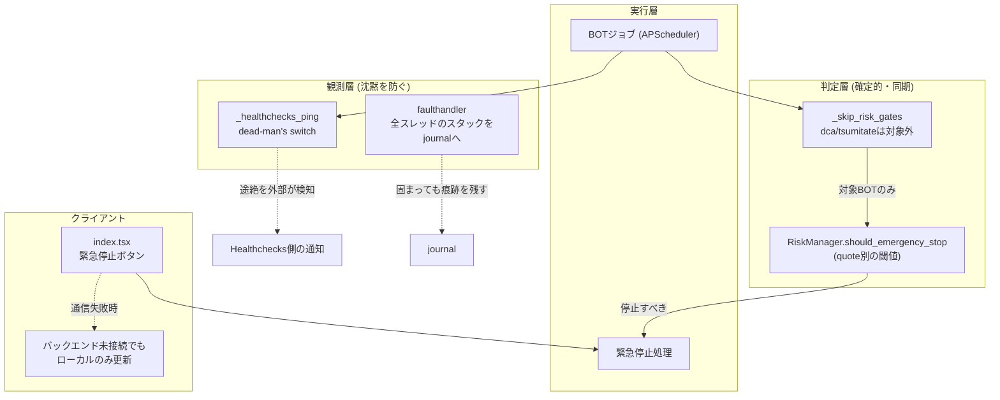

AutoTrader (FastAPI × React Native Expo 製) の自動売買botで、緊急停止 (kill switch) と例外処理をどう設計したかを整理した。制約は「BOT は毎分回る」「個人運用でレビュー体制を厚くできない」「本番は Render free + `gunicorn -w 1` の単一ワーカー」の3つ。この記事では、「止める機能がある」だけでは足りず、誤って止まる・止める処理が固まる・止まったことに気づけない、という3つの失敗をどう設計で潰そうとしたかを、与えられたコード抜粋から読み取れる範囲で書く。

## 前提

### 解きたい問題

kill switch は「止めたいときに確実に止まる」ことが本分に見える。ただ、材料のコードを読むと、実際にぶつかっているのは別の種類の問題だった。

- **誤発火**: 止めなくてよいときに止まる。`TROUBLESHOOTING.md` の TS-08 には、ドローダウン 147.1% (制限の150%超過に近い値) で `EMERGENCY_STOP` が出て、スキャルピングBOTが数分で再停止するループに入った症状が、実際の変動は1円だったという見出しとともに残っている。
- **ブロック**: 止める・監視する側の処理自体が固まる。`test_database_timeouts.py` には、真因が「イベントループのブロック」で、`async def _run_bot_job_inner` が同期 `SessionLocal()` を使っていて DB が詰まるとループごと止まる、とある。
- **沈黙**: 止まっても (あるいは止まらなくなっても) 誰も気づかない。`scheduler.py` の `_healthchecks_ping` は dead-man's switch として、ping の途絶を外部に検知させる。

つまり「止める処理」だけを作っても、止まりすぎる・止められない・気づけないが残る。この3方向を別々の層で受ける設計にした。

### 環境

- FastAPI (バックエンド) / React Native Expo (クライアント)
- APScheduler (BOT ジョブ)
- PostgreSQL (DB は別サーバ、ネットワーク越し)
- Render free + `gunicorn -w 1` (単一 uvicorn ワーカー)
- 個人運用、複数 BOT が並行稼働

## 設計案の比較

比較したのは「緊急停止の判定をどこに置き、どう守るか」。評価軸は「誤発火の起きにくさ」「判定経路の確定性」「個人運用での保守しやすさ」の3つ。

### 案A: 閾値を1つ決めて、全BOT・全通貨に同じ値を適用する

`daily_loss_limit` などを固定値で持ち、`daily_pnl` と直接比較して超えたら停止する。

**メリット**: 実装が最も単純で、判定も読みやすい。

**デメリット**: 通貨の単位が違うと破綻する。`risk_manager.py` のコメントによると、`daily_loss_limit` / `weekly_loss_limit` は元来 USDT スケール (500 / 2000) で設計されていた。比較相手の `daily_pnl` / `weekly_pnl` は BOT の quote 通貨で累積されるため、BTC/JPY BOT なら円建てになる。両者を換算せず直接比較していたので、JPY 建て BOT には約150倍厳しい閾値がかかり、¥950 の実損 (≒ $6) で緊急停止が誤発火した (2026-07-08)。

### 案B: 為替APIで換算してから比較する

JPY の損益を USD に換算してから、USDT スケールの閾値と比較する。

**メリット**: 閾値を1組だけ持てば済み、設定が増えない。

**デメリット**: リスク判定の経路に外部の為替 API 依存が入る。判定が同期的・確定的でなくなり、API が遅い・落ちているときに「止めるべきかの判断」自体が不安定になる。

### 案C: quote 通貨別に同一単位のデフォルトを引く (採用)

換算はせず、`QUOTE_LOSS_LIMIT_DEFAULTS` のように quote 別の閾値テーブルを持ち、`daily_pnl` と同じ単位の閾値を引く。基準レートは `portfolio.py` の USD/JPY フォールバックと同じ ≈150 を使う。

**メリット**: 比較が常に同一単位で行われ、リスク判定経路が確定的 (同期・為替 API 非依存) なまま保てる。

**デメリット**: 通貨ごとにデフォルトを持つ必要がある。基準レートは固定値なので、実際の為替とずれる可能性は残る。

**案Bと案Cを比較して案Cを選んだ理由**: 案Bは設定が少なくて済むが、「止めるかどうかの判断」が外部 API の状態に左右される。kill switch は、まさに他の何かが調子を崩している最中に動いてほしい機構で、その判断経路に外部依存を足したくなかった。コメントにもあるとおり、リスク判定経路は確定的 (同期・為替 API 非依存) に保ちたいので換算はせず、単位をそろえたデフォルトを引く方を選んだ。代償は、通貨ごとの閾値を管理することと、固定の基準レートが現実からずれうることだ。

## 採用した設計

設計の要点は、判定・実行・観測の3層に分け、それぞれが別の失敗を受け持つことにある。

### 判定層: 「止めなくてよい BOT」を先に除外する

`engine.py` の `_skip_risk_gates` は、リスクゲート (連敗停止 / 日次・週次損失上限 / ドローダウン / 緊急停止) をスキップすべきかを判定する。コメントには、dca / tsumitate は「下がったら買い増す」設計で、連敗・ドローダウンという概念がそぐわない、という趣旨が書かれている。買い増しが前提の戦略に、含み損を理由にした停止をかけると、戦略の動作そのものと衝突する。「どの BOT に kill switch の判定を適用するか」を最初に切り分けることで、誤発火の母数を減らしている。

テストにも判定の期待値が残っている。`test_safety.py` の `test_emergency_stop_daily_loss` は、日次損失上限 100.0 に対して `daily_pnl=-160.0` (150%超) を与え、緊急停止が返ることを確認している。

### 実行層: クライアントからの停止は通信失敗を前提にする

`app/index.tsx` の緊急停止完了時の処理は、`Platform.OS === "web"` なら `window.alert`、それ以外は `Alert.alert("緊急停止完了", msg)` で結果を出し分ける。そして `catch` 側のコメントには「バックエンド未接続時はローカルのみ更新」とある。急落時に押される操作で、バックエンドへの接続が取れないことは普通に起こりうる。そのとき例外で画面を固めるのではなく、手元の状態は更新して操作を終わらせる。サーバー側の停止が走らなかった可能性は残るが、押した操作が無反応になるよりは、UI 上で停止状態が明示される方を選んだ。

### 観測層: 沈黙を2通りの手段で防ぐ

`_healthchecks_ping` は、Healthchecks.io へのハートビート (dead-man's switch) だ。`HEALTHCHECKS_PING_URL` 設定時のみ送信し、ping が途絶えたら Healthchecks 側が通知する。送信失敗は本体に影響させず握る、とコメントにある。監視の仕組みが原因で本体が落ちるのは本末転倒なので、監視側の例外は握り潰す方向に倒している。

もう1つが `main.py` の `faulthandler.enable(all_threads=True)` だ。コメントによると、handler が走らず SIGKILL に至ったケース (主スレッドが C レベルで固まっている疑い) があり、faulthandler は C レベルの handler なので、その状態でも全スレッドのスタックを stderr (journal) に吐ける。dump 後は既定動作 (abort) で落ちるため、gunicorn が kill する結果は同じで、スタックだけが残る。止まること自体は防げないが、「なぜ止まったか」を後から追える形にしている。

## 実装上の罠

### 罠1: 単位の異なる値を直接比較している

最大の罠は案Aの節で書いた単位ずれだった。閾値の設計時点では USDT 前提だったものが、後から JPY 建ての BOT が加わって前提が崩れた。¥950 の実損で緊急停止が誤発火したのは、コードが壊れていたのではなく、比較の前提が暗黙のまま残っていたことによる。閾値を持つ設計では、その値がどの単位を前提にしているかをコメントなり型なりで固定しておく必要がある。

### 罠2: async ルートの中で同期 I/O を回している

`test_database_timeouts.py` が示す真因は、`async def _run_bot_job_inner` が同期 `SessionLocal()` を使っている点だった。DB は別サーバなので、DB が詰まると同期クエリがイベントループごと止める。kill 直前に APScheduler が全ジョブ同時に `Run time of job ... was missed by 0:01:32` を出していた観測と整合する、とある。止める側・監視する側のジョブも同じループ上にいるので、ループが固まれば kill switch も動かない。「止める機構が、止めたい対象と同じ待ち行列に乗っている」のは、設計上かなり危うい。

`sales.py` の Stripe webhook の記述も同じ根の問題を示している。本番は Render free + `gunicorn -w 1` で、処理を async ルート内でインライン実行すると、同期ブロッキング I/O がイベントループを固め、その間ヘルスチェックも捌けず、gunicorn のデフォルト 30s タイムアウトでワーカーが kill され、Render が 503 を返す。Stripe には「47 回 503」として記録される事象だった。対策の方向として、署名検証後すぐ 200 を返せば Stripe のリトライ (503) も止まる、と書かれている。重い処理を応答経路から切り離す、という考え方になる。

### 罠3: 監視の失敗を本体に波及させない

`_healthchecks_ping` が送信失敗を握るのは、ping 先の不調で本体のジョブが失敗する事態を避けるためだ。dead-man's switch は「届かなくなったら気づく」仕組みなので、送信側で例外を握っても、途絶という形で外部に伝わる。握ることで検知が失われるわけではなく、むしろ本体を守りつつ検知を成立させている。

### 罠4: 誤停止の症状は「止まった」としか見えない

TS-08 の症状は、スキャルピングBOTが起動できず、起動しても数分で `EMERGENCY_STOP: ドローダウンが制限の150%超過: 147.1%` で再停止するループだった。実際の変動は1円と見出しにある。ユーザーから見ると「勝手に止まる」としか映らず、kill switch が正常に動いた結果なのか誤動作なのかが区別できない。停止理由を文字列で残していること (`EMERGENCY_STOP: ...` に理由と数値が入る) が、原因切り分けの手がかりになる。

## 振り返り

kill switch を「止める機能」として作ると、設計の関心が閾値と停止処理に寄る。材料から見えた実際の失敗は、閾値の単位ずれによる誤発火、同期 I/O によるループのブロック、止まったことに気づけない沈黙の3つで、どれも「止める処理そのもの」の外側にあった。

自分の判断は、判定層は確定的・同期に保ち (為替 API を挟まない)、実行層は通信失敗を前提にし、観測層は本体と切り離して沈黙を防ぐ、という分担にした。

この記事の限界も書いておく。緊急停止がサーバー側でどう BOT を停止状態に遷移させるか、停止後の復帰手順、`QUOTE_LOSS_LIMIT_DEFAULTS` の具体的な値は、与えられた材料に現れないので扱っていない。また `_healthchecks_ping` や faulthandler が検知・記録できるのは異常の痕跡までで、異常を自動で直すものではない。誤発火を減らす層、止められなくなる事態を減らす層、気づけるようにする層は、それぞれ別の失敗を受け持つもので、どれか1つで他を代替できない。この前提で、3つを重ねて使うのが自分の設計だった。

---

## 関連リンク

[AutoTrader 実装学習キット (FastAPI × React Native)](https://autotrader.ponfreelance.com/sales/?utm_source=zenn&utm_medium=article&utm_campaign=%E4%BE%8B%E5%A4%96%E5%87%A6%E7%90%86%E3%81%A8%E5%AE%89%E5%85%A8%E3%81%AA%E7%B7%8A%E6%80%A5%E5%81%9C%E6%AD%A2-kill-switch)

by ぽん ([@pon_freelance](https://x.com/pon_freelance))

**開発の裏側を購読できます** — AutoTrader のリリースごとに「何を・なぜ・どう変えたか」を 2,000〜4,000 字で書き残しています。バグの原因、取引所 API 変更への追従、設計判断のトレードオフまで。
→ [AutoTrader開発ログ（月500円・いつでも解約可）](https://note.com/clab_jp/membership)
