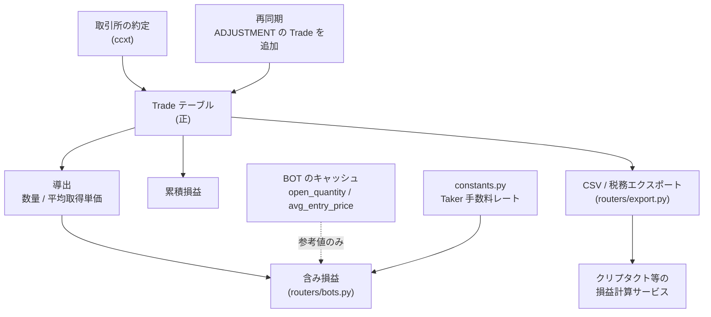

AutoTrader (FastAPI × React Native Expo 製) の自動売買botで、損益計算と税務向けエクスポート (クリプタクト等の損益計算サービスに渡す CSV の出力) をどういう前提で組んだかを整理した。制約は「BOT は毎分回る」「個人運用でレビュー体制を厚くできない」「BOT を削除しても取引の記録は残したい」の3つ。この記事は、与えられたコード抜粋から読み取れる範囲の設計判断の解説として書く。税額の計算ロジックそのものや、特定サービスへの連携フォーマットの詳細は材料に現れないため扱わない。あくまで「損益と税務の元になる記録を、どう壊さずに持つか」の話になる。

## 前提

### 解きたい問題

自動売買の損益は、画面に出す含み損益、BOT ごとの累積損益、年間の税務用の損益の3つで見られ方が違う。一方で、元になる事実は「いつ、どの取引所で、何を、いくらで売買したか」という約定の記録しかない。ここがずれると、どの集計も信用できなくなる。

材料から読み取れる関連部分は次のとおり。

- `backend/constants.py` は「取引所手数料レートと損益計算ユーティリティ」をまとめるモジュール。Taker 手数料レート (成行注文・板を食う注文) を取引所ごとに持つ。コメントには、手数料は変更される場合があるので定期的に公式サイトで確認すること、とある
- `backend/routers/bots.py` の含み損益計算は、BOT の `open_quantity` / `avg_entry_price` のキャッシュではなく、Trade 由来の値で算出する (Phase 3b)
- `backend/tests/test_database.py` には、BOT を削除しても Trade 記録は残る (累積損益計算に使用)、削除後の `bot_id` は NULL になる、というテストがある
- `docs/package-definition.md` のルーター構成には、`export.py` が「CSV/税務エクスポート」として載っている
- `docs/reports/lp-audit-2026-08-15.md` には、LP の FAQ に「税務処理はどうなる？」を追加する提案がある。日本ユーザーの定番の懸念として挙がっている

### 環境

- FastAPI (バックエンド) / React Native Expo (クライアント)
- ccxt (複数取引所)
- PostgreSQL (Trade テーブル)
- 個人運用、複数 BOT が並行稼働

## 設計案の比較

比較したのは「損益の数字を、どこを正として持つか」という1点。評価軸は「再同期や補正をしても数字が一貫すること」「BOT を消しても過去の損益が消えないこと」「税務向け出力の元として説明できること」の3つ。

### 案A: BOT ごとにキャッシュした集計値を正とする

BOT のレコードに数量・平均取得単価・累積損益を持たせ、約定のたびに更新する。画面も出力もこの値を読む。

**メリット**: 読み出しが速く、実装も単純に見える。

**デメリット**: キャッシュは更新の漏れや二重更新でずれる。ずれたときに、どちらが正しいかを確かめる元がない。さらに、再同期のような補正処理がキャッシュを書き換える設計だと、過去の数字が操作のたびに変わりうる。

### 案B: 取引の記録 (Trade) を正とし、必要なときに導出する (採用)

数量や平均取得単価、含み損益は、Trade の履歴から都度導出する。BOT 側のキャッシュは参考値に留める。

**メリット**: 元の事実が1つなので、どの画面・どの出力も同じ根拠から計算できる。キャッシュがずれても、導出し直せば直る。

**デメリット**: 読み出しのたびに計算するコストがある。導出ロジックを共通化しておかないと、画面ごとに計算が食い違う。

### 案C: 税務出力専用に別の集計テーブルを持つ

エクスポート用に、年次の損益を別テーブルへ貯める。

**メリット**: 出力が軽い。

**デメリット**: 約定の記録と別の「もう1つの正」が増える。ずれたときの照合が増え、個人運用では維持しづらい。

**案Aと案Bを比較して案Bを選んだ理由**: 含み損益のコードコメントに、キャッシュだけを読むと「再同期完了したのに含み損益が変わらない」というユーザー報告の挙動になった (2026-04-25)、とある。再同期 (ADJUSTMENT の Trade を追加する処理) がキャッシュを書き換えない設計である以上、キャッシュだけを読む画面は、補正の結果を反映できない。案Aは読み出しが軽い代わりに、「どの数字が正か」を後から確かめる手段が無い。案Bは計算コストを払う代わりに、記録さえ正しければ数字を作り直せる。税務に使う数字は、後から説明できることを優先して、記録を正にする案Bを選んだ。案Cは、正を2つに増やす点で個人運用に向かないと判断した。

## 採用した設計

設計の要点は次の3つ。

1. **Trade を正にする**: 含み損益は、Trade 由来の値で算出する。BOT のキャッシュ (`open_quantity` / `avg_entry_price`) は読まない。
2. **補正は書き換えでなく追記**: 再同期は ADJUSTMENT の Trade として記録を足す。キャッシュを直接書き換えない設計なので、補正の履歴が Trade に残り、導出し直せば結果が変わる。
3. **BOT より記録を長生きさせる**: テストが示すとおり、BOT を削除しても Trade は残り、`bot_id` が NULL になる。累積損益の計算は、この残った記録を使う。

### 手数料の扱い

`constants.py` は取引所ごとの Taker 手数料レートを持つ。コメントのとおり、手数料は変更されうる値で、公式サイトでの定期確認が前提になっている。損益の計算に手数料を含める以上、この値が古いと損益も実態からずれる。コードに埋め込まれた定数は、更新を忘れたことに気づきにくい。「定期的に公式で確認する」という運用上の約束をコメントとして残すことで、少なくとも前提が暗黙にならないようにしている。

### 税務エクスポートの位置づけ

`export.py` は CSV / 税務エクスポートを担当するルーターで、元データは Trade になる。ここで意識したのは、エクスポートが別の計算をしないことだ。画面の損益と出力の損益が別々の経路から出ると、数字が食い違ったときにどちらを信じるかが決められない。出力は Trade の記録を外部サービスが読める形に並べ替える役に留め、損益の最終的な計算は外部の損益計算サービスに委ねる前提にしている。

## 実装上の罠

### 罠1: BOT を消すと過去の損益も消える

BOT のレコードに損益を紐づけていると、BOT を削除した時点で累積損益が計算できなくなる。テストで「BOT 削除後も Trade が残り、`bot_id` は NULL」を確認しているのはそのためで、記録の寿命を BOT の寿命から切り離している。

### 罠2: 記録だけが残ると、実取引と区別がつかなくなる

ペーパートレード (取引所に実発注せず、ティッカー価格で約定したものとして記録する練習モード) では、取引履歴や損益計算が本番と同じように動く。画面では「📝 PAPER」バッジや損益の「(ペーパー)」表記で、実資金と混同しないようにしている。ただし、これは表示側の対策であり、記録側の問題は残る。`docs/superpowers/plans/2026-10-09-self-check.md` には、paper の印が BOT の config にしか無いため、BOT を削除して `Trade.bot_id` が NULL になると、税務 CSV や未割当集計に実取引として混ざる、という指摘がある。BOT 削除後も記録が残る設計と、練習用の記録が残ることが、税務出力の文脈では衝突する。この計画では、後片付けを「残置」でなく「削除」にするテストを固定している。記録を残す設計を採ったことの副作用なので、どの記録を残し、どれを消すかの線引きは、設計の一部として扱う必要がある。

### 罠3: 含み損益が約定価格の決め方に引きずられる

`engine.py` の `paper_fill_price` は、指値を市場価格で頭打ちにして paper の約定価格を決める。コメントによると、MM の利確を目標価格のまま合成したために、市場との差だけ損益が過小になったことがあった (2026-09-10)。損益の元になる約定価格が実態とずれれば、導出した損益もずれる。Trade を正にする設計は、正の中身が正しいことを前提にしている。

### 罠4: 受け取った資産の税務は別問題として扱う

`docs/superpowers/specs/2026-08-27-xym-payment-design.md` には、販売代金を XYM で受け取る場合の税務の記述がある。受取時の時価で売上計上し、受け取った XYM の保有・売却は別勘定にする、という運用ルールだ。これは自動売買の損益とは別の話で、同じ「税務」という言葉でも、扱う記録と勘定が違う。損益計算の仕組みに混ぜず、別の帳簿の問題として切り分けている。

## 振り返り

損益計算と税務出力は、計算ロジックの巧みさより、元になる記録をどう持つかで決まると考えている。自分の判断は、Trade を唯一の正とし、補正は追記で行い、記録の寿命を BOT から切り離す、というものだった。キャッシュを読む設計は速いが、ずれたときに確かめる手段が無い。記録から導出する設計は、読み出しの手間と引き換えに、後から作り直せる。

この記事の限界も書いておく。税額の計算方法、各取引所の約定を損益計算サービスの取り込み形式へ変換する詳細、エクスポートされる CSV の列定義は、与えられた材料に現れないので扱っていない。また、この記事は設計判断の解説であり、税務上の取り扱いについて助言するものではない。実際の申告に関わる判断は、利用する損益計算サービスの仕様や、税の専門家への確認が必要になる。

もう1つ、残る課題として、練習用の記録と実取引の記録の線引きがある。記録を残す設計を採ったことで、残すべきでない記録が税務出力に紛れ込む余地が生まれた。記録を正にする設計は、正に入れる記録を選ぶ責任もセットで負う、というのが振り返りでの結論になる。

---

## 関連リンク

[AutoTrader 実装学習キット (FastAPI × React Native)](https://autotrader.ponfreelance.com/sales/?utm_source=zenn&utm_medium=article&utm_campaign=%E6%90%8D%E7%9B%8A%E8%A8%88%E7%AE%97%E3%81%A8%E7%A8%8E%E5%8B%99-%E3%82%AF%E3%83%AA%E3%83%97%E3%82%BF%E3%82%AF%E3%83%88%E9%80%A3%E6%90%BA)

by ぽん ([@pon_freelance](https://x.com/pon_freelance))

**開発の裏側を購読できます** — AutoTrader のリリースごとに「何を・なぜ・どう変えたか」を 2,000〜4,000 字で書き残しています。バグの原因、取引所 API 変更への追従、設計判断のトレードオフまで。
→ [AutoTrader開発ログ（月500円・いつでも解約可）](https://note.com/clab_jp/membership)
